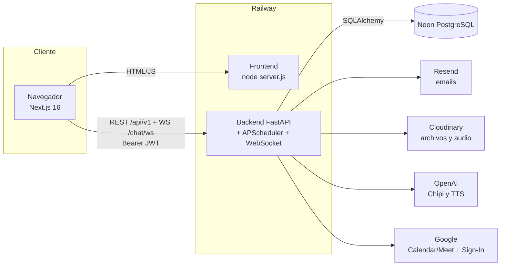
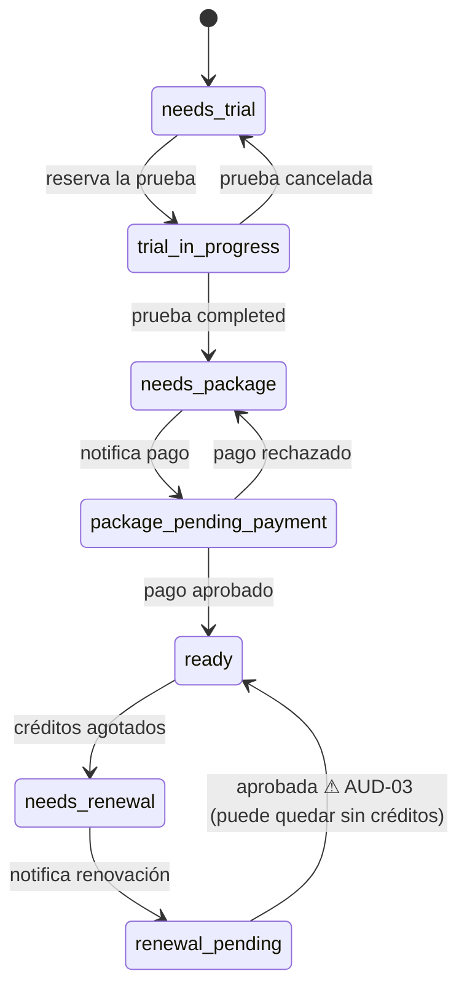
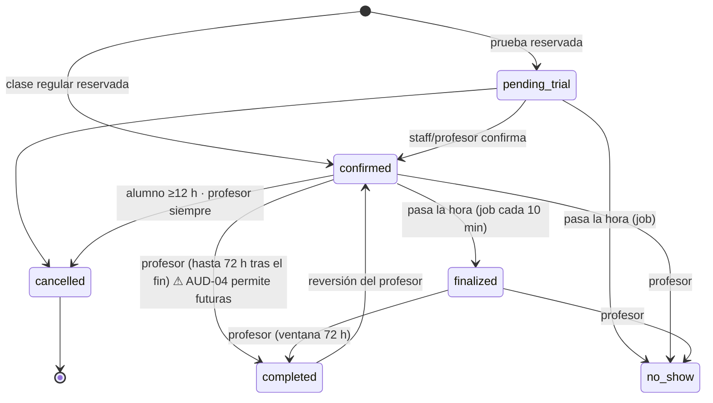
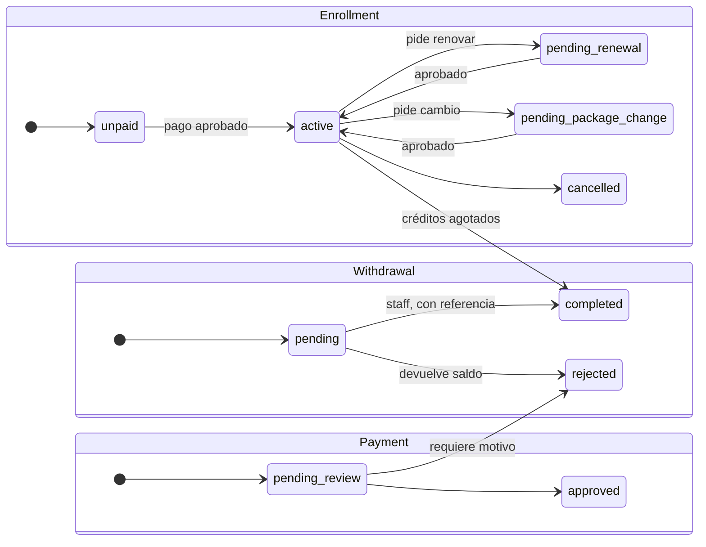
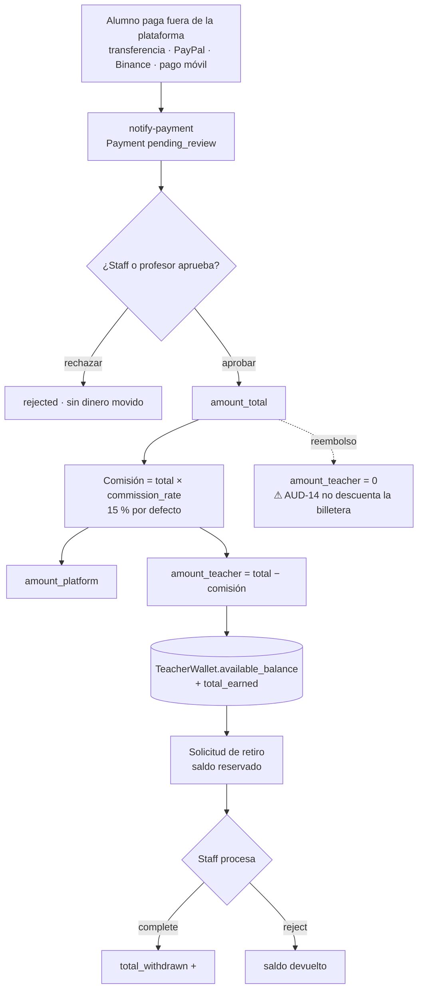
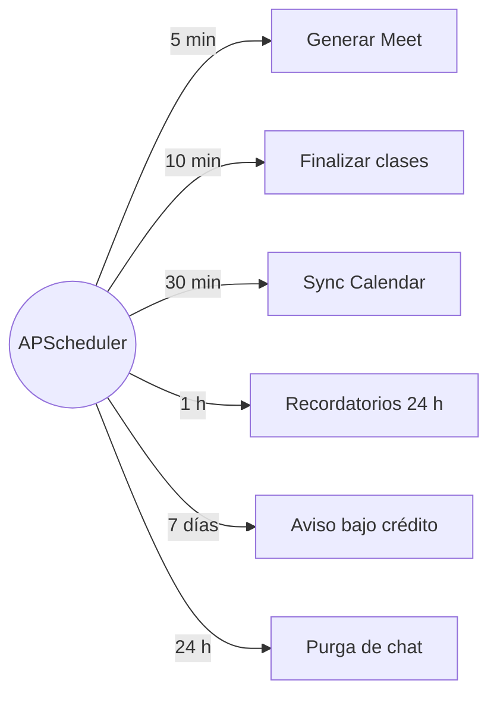

# Dominio y diagramas

Los diagramas usan [Mermaid](https://mermaid.js.org/) (GitHub y la mayoría de editores los renderizan). Reflejan el **comportamiento actual** del código; donde difiere de lo deseable se marca con ⚠ y el ID de `KNOWN_ISSUES.md`.

## 1. Glosario

| Término | Significado | Dónde vive |
|---|---|---|
| **User** | cuenta con rol (`student`, `teacher`, `teacher_admin`, `superadmin`) | `models/user.py` |
| **StudentProfile / TeacherProfile** | datos específicos del rol; el profesor tiene `status` (`pending`, `approved`, `suspended`…), `commission_rate`, zona horaria, lista de alumnos | `models/student.py`, `teacher.py` |
| **Clase de prueba (trial)** | primera clase con un profesor; no consume paquete; necesaria antes de comprar; cada profesor exige la suya | `Class.class_type='trial'` |
| **Package (paquete)** | producto del profesor: N clases por un precio (`price_per_class × N = price`), o **ilimitado** (créditos prepagados), con cuotas opcionales | `models/package.py` |
| **Enrollment (inscripción)** | relación alumno–profesor–paquete comprada; guarda créditos y estados de pago | `models/package.py` |
| **Crédito** | derecho a agendar una clase. Se libera al aprobar el pago (`unlocked_credits`) y se *ocupa al agendar* | `Enrollment` |
| **Cuota (installment)** | pago parcial de un paquete; cada una desbloquea créditos proporcionales | `Package.allow_installments` |
| **Payment** | pago notificado por el alumno (`pending_review → approved/rejected`); incluye comisión | `models/payment.py` |
| **Comisión** | porción de la plataforma (15 % por defecto, por profesor), fijada al aprobar el pago | `TeacherProfile.commission_rate` |
| **TeacherWallet** | saldo del profesor: `available_balance`, `total_earned`, `total_withdrawn` | `models/payment.py` |
| **Withdrawal** | solicitud de retiro del profesor, procesada por staff | `models/payment.py` |
| **Cohorte (cohort)** | grupo de alumnos con un profesor para clases grupales (`filling → …`) | `models/group_cohort.py` |
| **ClassParticipant** | alumno participante de una sesión grupal | `models/class_participant.py` |
| **Buffer** | margen de preparación entre clases (5/10/10 min) que ocupa agenda | `PlatformConfig` |
| **Etapa de reserva** | estado del alumno con un profesor: `needs_trial`, `trial_in_progress`, `needs_package`, `package_pending_payment`, `ready`, `needs_renewal`, `renewal_pending`, `needs_group_refund` | `get_student_booking_stage` |
| **God Mode** | edición administrativa directa con motivo y auditoría | `endpoints/god_mode.py` |
| **Chipi** | asistente de IA (OpenAI) con contexto por rol y pantalla | `core/chipi/` |
| **PlatformConfig** | única fila de configuración: reglas de tiempos, duraciones, buffers, chat, landing, modo single/multi-tenant | `models/payment_config.py` |
| **single-tenant** | modo de un solo profesor destacado (`FEATURED_TEACHER_USERNAME`) | `PlatformConfig.is_single_tenant` |

## 2. Arquitectura



## 3. Etapas de reserva del alumno (por profesor)



## 4. Estados de una clase


`classes_used` sube con `completed` y `no_show`. Una `finalized` que el profesor no resuelve **no cuenta** y queda en limbo (decisión de negocio abierta).

## 5. Estados de la inscripción y del pago


`payment_status` del enrollment: `unpaid → partially_paid → paid` (cuotas).

## 6. Flujo principal (secuencia)

```mermaid
sequenceDiagram
  actor Al as Alumno
  participant Web as Frontend
  participant API as Backend
  actor Pr as Profesor/Staff
  Al->>Web: reserva prueba
  Web->>API: POST /payments/book (etapa needs_trial crea la prueba; staff usa POST /classes/trial)
  Pr->>API: PATCH /classes/{id}/status completed
  Al->>API: POST /payments/notify-payment {package}
  API-->>Pr: email "pago pendiente"
  Pr->>API: PATCH /payments/{id}/validate approve
  API->>API: comisión · billetera · créditos · email recibo
  Al->>API: POST /payments/book (clase)
  API->>API: can_book_slot · crédito ocupado · email · Calendar
  Note over API: job: crea Meet ~30 min antes · recordatorio 24 h
  Pr->>API: marca completed/no_show
  Pr->>API: POST /payments/request-withdrawal
  Pr->>API: (staff) /payments/admin/withdrawals/{id}/process
```

## 7. Flujo del dinero


El dinero real nunca pasa por la plataforma: es un libro contable; el staff paga los retiros fuera.

## 8. Modelo de datos (núcleo)

```mermaid
erDiagram
  USER ||--o| STUDENT_PROFILE : tiene
  USER ||--o| TEACHER_PROFILE : tiene
  TEACHER_PROFILE ||--o{ PACKAGE : ofrece
  TEACHER_PROFILE ||--o{ TEACHER_AVAILABILITY : define
  TEACHER_PROFILE ||--|| TEACHER_WALLET : acumula
  STUDENT_PROFILE ||--o{ ENROLLMENT : compra
  PACKAGE ||--o{ ENROLLMENT : origina
  ENROLLMENT ||--o{ CLASS : consume
  ENROLLMENT ||--o{ PAYMENT : "se paga con"
  TEACHER_PROFILE ||--o{ CLASS : imparte
  STUDENT_PROFILE ||--o{ CLASS : asiste
  GROUP_COHORT ||--o{ CLASS : sesiones
  CLASS ||--o{ CLASS_PARTICIPANT : "grupal"
  TEACHER_PROFILE ||--o{ WITHDRAWAL : solicita
  TEACHER_PROFILE ||--o{ REVIEW : recibe
```
Todas las tablas y columnas: `backend/doc/generated/MODELS.md` (34 tablas).

## 9. Scheduler


